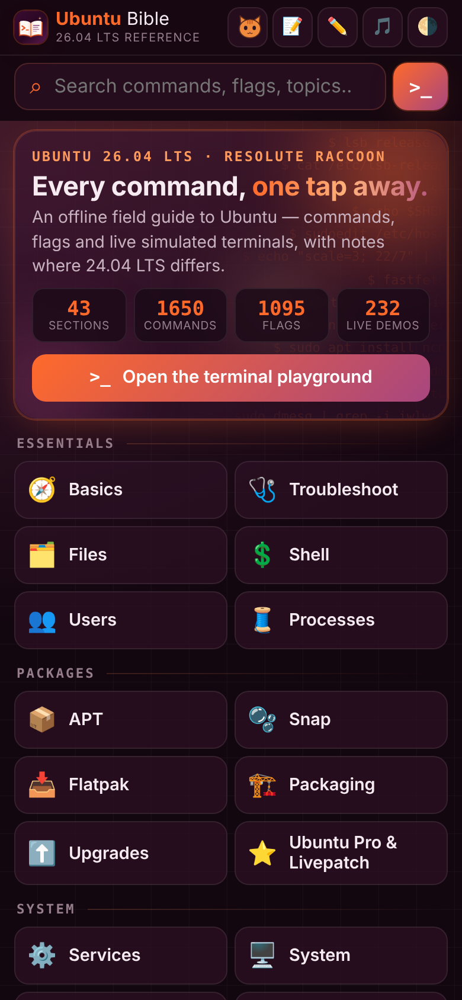
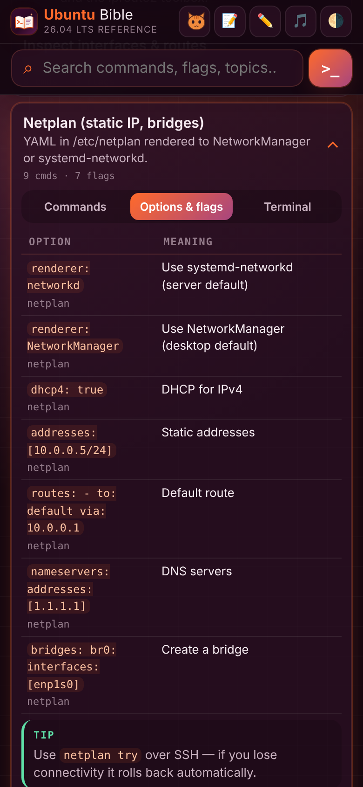
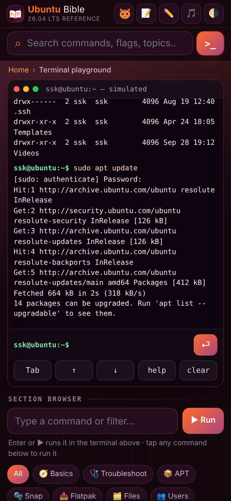
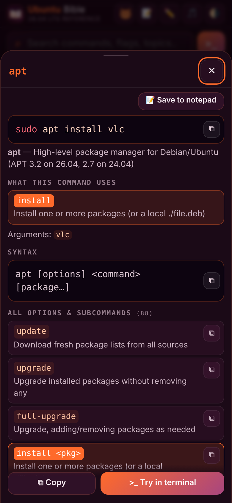

# Ubuntu Bible

**An offline Ubuntu Linux command reference for Ubuntu 26.04 LTS, with a simulated terminal playground.**
Notes mark where 24.04 LTS differs. It is mobile-first and installable as a PWA, with no build step and no dependencies.

<p align="center">
  
  
  
  
</p>

> Output is simulated: nothing runs on your device.

## Features

- **43 sections, 214 cards, 1,650+ commands, 1,000+ flags.** The sections run from basics, APT, Snap and Flatpak to networking, firewall, systemd, storage, security, containers and troubleshooting.
- **Cards** have three tabs:
  - **Commands:** each one with a description.
  - **Options & flags:** a table of what each option does.
  - **Terminal:** a live example.

  Each card also carries tips, warnings and 24.04 notes.
- **Command pop-up:** Tap any command to see what it uses, its syntax, every option (each with a copy button), examples, and related commands. You can also save it to the notepad.
- **Terminal playground:**
  - **Simulated shell:** A virtual filesystem (`cd`, `ls`, `cat`, `mkdir`, `rm` and more) and a root shell via `sudo -i`.
  - **Chaining:** `&&`, `||` and `;` work, and pipes go through `grep`, `head`, `sort`, `wc` and similar tools.
  - **Built-ins:** `help`, `man`, `search`, `examples`, `history` and `clear`.
  - **Input:** Tab completion and a section browser.
- **Search:** Finds commands, flags and topics. Deep links use hash routes such as `#network/netplan/flags`.
- **Extras:**
  - A quick **notepad**.
  - An **ambient music** mini player with three generated tracks. It uses Web Audio, can be dragged, and can be swiped into a bubble.
  - An animated **cat companion** that reacts to what you visit.
  - A dark/light theme.
  - An animated hero.
  - A full *How to use* guide in About.
- **Offline-first:** A service worker precaches every asset, and the app can be installed on Android, iOS and desktop.

## Run locally

It is a static site, so any web server works:

```bash
python3 -m http.server 8000
# open http://localhost:8000
```

The service worker needs `http://localhost` or HTTPS, so opening `index.html` straight from disk works but won't install offline.

## Deploy to GitHub Pages

1. Push this repo to GitHub, using `main` as the default branch.
2. Go to **Settings → Pages → Build and deployment → Source** and choose **GitHub Actions**.
3. The included workflow (`.github/workflows/pages.yml`) deploys on every push to `main`. The site is published at `https://<user>.github.io/<repo>/`.

All paths are relative, so the app works from a sub-path.

## Releasing an update

1. Change the content or code.
2. Bump `VERSION` in `js/core.js`, for example `1.9.0` → `1.10.0`. This renames the offline cache so installed copies update.
3. Run the build:

   ```bash
   python3 build.py
   ```

   It regenerates `sw.js` (cache name and precache list) and writes these files to `../dist/`:
   - `ubuntu-bible.zip`: the full PWA.
   - `index.html`: a single-file preview with everything inlined.
4. Commit `sw.js` together with your changes.

## Project structure

```
index.html              App shell (header, search, view, sheet)
manifest.webmanifest    PWA manifest
sw.js                   Service worker (generated by build.py)
build.py                Builds sw.js, the zip and the single-file preview
css/style.css           Theme tokens, layout, animations
js/core.js              Data registry: UB.sec / UB.add / UB.tools, VERSION
js/tools.js             Per-tool syntax, descriptions and options (pop-up, man, --help)
js/outputs.js           Pattern-based simulated output
js/outputs2.js          Exact simulated outputs
js/data/d1–d9.js        Sections and cards (content)
js/shell.js             Virtual filesystem and shell features
js/app.js               Rendering, router, search, terminal, notepad, music
js/cat.js               Cat companion
icons/                  App icons (SVG + PNG, maskable, apple-touch)
docs/screenshots/       README images
```

### Adding content

```js
UB.add('network', [{
  id: 'mycard', title: 'Card title', intro: 'One-line summary',
  cmds: [                                   // one command per row: [cmd, description, optional output]
    ['ip -br a', 'Brief address list'],
    ['ip r', 'Routing table']
  ],
  flags: [['-br', 'Brief output', 'ip']],   // [flag, meaning, optional tool]
  demo: [['ip -br a', 'lo        UNKNOWN  127.0.0.1/8\nenp1s0    UP       10.0.0.5/24']],
  tips: ['…'], warn: ['…'], v24: 'How 24.04 differs'
}]);
```

New sections use `UB.sec({ id, title, icon, desc, cards: [...] })`. Add any new JS file to `index.html` and to the `assets` list in `build.py`.

## Credits

Created by **SSK-BLUM**. Contact: [soorajsknairqa@gmail.com](mailto:soorajsknairqa@gmail.com)

## Disclaimer

Ubuntu® is a registered trademark of Canonical Ltd. This is an unofficial reference and is not affiliated with or endorsed by Canonical. The app icon is an original design.
